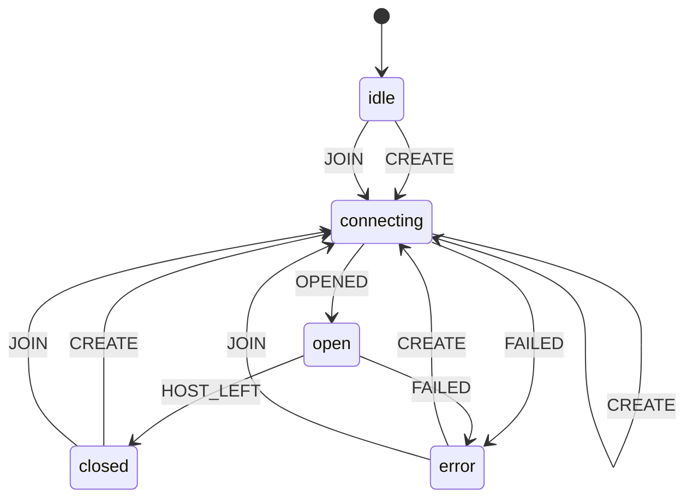
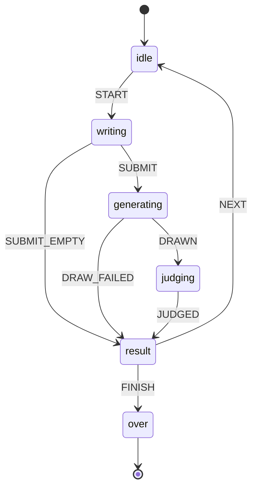

# State machines

<!-- Generated by `npm run docs:machines` from src/machines. Do not edit by hand. -->

Every multi-step flow in Gen Arcade is a small state machine in `src/machines/`.
Components run them with `useMachine` (src/hooks/useMachine.js) and put
`data-machine` and `data-state` on their root element. An event that the current
state does not list is ignored, so impossible steps cannot happen.

| Machine | States | Description |
|---|---|---|
| [`session`](#session) | 3 | Who is playing: checking a saved login, a guest, or a signed-in player. |
| [`credit-dialog`](#credit-dialog) | 3 | Asks the player before a game spends a credit, or says they are out of credits. |
| [`party-room`](#party-room) | 5 | Party room connection over PeerJS: create or join, play, leave. |
| [`speed-prompt`](#speed-prompt) | 6 | Speed Prompt, 5 rounds: write a prompt in 30 seconds, then the AI draws and the judge scores it. |

## session

Who is playing: checking a saved login, a guest, or a signed-in player.

```mermaid
stateDiagram-v2
  [*] --> checking
  checking --> signed-in: SIGNED_IN
  checking --> guest: SIGNED_OUT
  guest --> signed-in: SIGNED_IN
  signed-in --> signed-in: SIGNED_IN
  signed-in --> guest: SIGNED_OUT
```

| State | Meaning | Events |
|---|---|---|
| `checking` (start) | A saved login exists; asking the server if it is still valid | `SIGNED_IN` to `signed-in`, `SIGNED_OUT` to `guest` |
| `guest` | Playing without an account | `SIGNED_IN` to `signed-in` |
| `signed-in` | Logged in; scores go to the shared leaderboards | `SIGNED_IN` to `signed-in`, `SIGNED_OUT` to `guest` |

## credit-dialog

Asks the player before a game spends a credit, or says they are out of credits.

```mermaid
stateDiagram-v2
  [*] --> closed
  closed --> asking: ASK
  closed --> out-of-credits: ASK_EMPTY
  asking --> closed: ACCEPT
  asking --> closed: DECLINE
  out-of-credits --> closed: CLOSE
```

| State | Meaning | Events |
|---|---|---|
| `closed` (start) | No dialog | `ASK` to `asking`, `ASK_EMPTY` to `out-of-credits` |
| `asking` | "Use 1 credit?" with Use / Not now | `ACCEPT` to `closed`, `DECLINE` to `closed` |
| `out-of-credits` | No credits left: links to the credits page | `CLOSE` to `closed` |

## party-room

Party room connection over PeerJS: create or join, play, leave.



From any state: `LEAVE` goes to `idle`.

| State | Meaning | Events |
|---|---|---|
| `idle` (start) | Not in a room: create one or join with a code | `CREATE` to `connecting`, `JOIN` to `connecting` |
| `connecting` | Opening the room, or joining the host | `OPENED` to `open`, `FAILED` to `error`, `CREATE` to `connecting` |
| `open` | In the room (lobby or playing) | `HOST_LEFT` to `closed`, `FAILED` to `error` |
| `closed` | The host left; the player can create or join again | `CREATE` to `connecting`, `JOIN` to `connecting` |
| `error` | Could not open or join (bad code, full room, network) | `CREATE` to `connecting`, `JOIN` to `connecting` |

## speed-prompt

Speed Prompt, 5 rounds: write a prompt in 30 seconds, then the AI draws and the judge scores it.



From any state: `RESTART` goes to `idle`.

| State | Meaning | Events |
|---|---|---|
| `idle` (start) | Before the round starts | `START` to `writing` |
| `writing` | The 30 second timer runs; the player types a prompt | `SUBMIT` to `generating`, `SUBMIT_EMPTY` to `result` |
| `generating` | The AI draws the prompt | `DRAWN` to `judging`, `DRAW_FAILED` to `result` |
| `judging` | The AI judge scores the image | `JUDGED` to `result` |
| `result` | Round score shown | `NEXT` to `idle`, `FINISH` to `over` |
| `over` (end) | All rounds played; final score shown | none |
