# State machines

<!-- Generated by `npm run docs:machines` from src/machines. Do not edit by hand. -->

Every multi-step flow in Gen Arcade is a small state machine in `src/machines/`.
Components run them with `useMachine` (src/hooks/useMachine.js) and put
`data-machine` and `data-state` on their root element. An event that the current
state does not list is ignored, so impossible steps cannot happen.

| Machine | States | Description |
|---|---|---|
| [`session`](#session) | 3 | Who is playing: checking a saved login, a guest, or a signed-in player. |
| [`credit-dialog`](#credit-dialog) | 3 | Asks the player before a game spends a credit, or says they are out of credits. |
| [`party-room`](#party-room) | 5 | Party room connection over PeerJS: create or join, play, leave. |
| [`prompt-guesser`](#prompt-guesser) | 7 | Prompt Guesser, 5 rounds: guess the hidden prompt of an AI image; the guess is drawn and judged. |
| [`speed-prompt`](#speed-prompt) | 6 | Speed Prompt, 5 rounds: write a prompt in 30 seconds, then the AI draws and the judge scores it. |
| [`style-roulette`](#style-roulette) | 5 | Style Roulette, 5 rounds: name the art style of an AI image before the 15 second timer runs out. |
| [`spot-the-fake`](#spot-the-fake) | 5 | Spot the Fake, 5 rounds: find the one image made from a different prompt before the 20 second timer runs out. |
| [`ai-remix`](#ai-remix) | 6 | AI Remix: pick a starting image, then make 5 changes; the AI edits the image and the judge scores each change. |
| [`before-after`](#before-after) | 6 | Before & After, endless: the AI edits a scene with a chosen transformation and the judge scores it. Each round is saved and shared. |
| [`dream-caption`](#dream-caption) | 6 | Dream Caption solo, 3 rounds: the AI dreams up a surreal image, the player captions it, the AI judge scores the caption. |
| [`emoji-prompt`](#emoji-prompt) | 5 | Emoji Prompt solo, 5 rounds: describe a scene with emojis only, the AI draws the emojis, the AI judge checks the scene. |
| [`telephone-solo`](#telephone-solo) | 5 | Solo Telephone, 5 steps: the AI draws a secret prompt, the player describes each image, the judge compares the first and last image. |
| [`daily`](#daily) | 6 | Daily Challenge: the same 5 images for everyone today, one guess each, then a summary and leaderboard. Logging in or out starts the flow over. |
| [`haiku-canvas`](#haiku-canvas) | 3 | Haiku Canvas: write a 5-7-5 haiku, the AI paints it, then it is shared to the gallery. Repeats with no end. |
| [`community-comic`](#community-comic) | 4 | Community Comic: read the shared comic, write the next panel, the AI draws it and it joins the story. |
| [`infinimap`](#infinimap) | 5 | Infini-Map: one shared map; tap an empty tile, write a prompt, the AI paints it in the background. |
| [`submit-vote-party`](#submit-vote-party) | 6 | Party round for Dream Caption and Emoji Prompt, run by the host: pick a challenge, everyone submits, everyone votes, results. Every device shows the same phase. |
| [`party-entry`](#party-entry) | 3 | A player's entry in a party round, on their own device: write it, run the AI calls, send it to the host. |
| [`dream-pick`](#dream-pick) | 4 | Dream Caption party, host only: make a dream image for everyone to caption, or try a new one. |
| [`telephone-party`](#telephone-party) | 5 | Telephone party (host side): chains rotate between players each step, then the host reveals them and everyone votes. |
| [`telephone-turn`](#telephone-turn) | 3 | My Telephone party turn on this device: write, the AI draws it, then it goes to the host. |
| [`prompt-off`](#prompt-off) | 7 | Prompt Off duel: two players race 60 seconds to recreate a theme with live AI images, then the audience votes. |
| [`prompt-off-link`](#prompt-off-link) | 5 | Prompt Off player link over PeerJS: the host opens a room, the guest joins it, one opponent at a time. |
| [`prompt-off-vote`](#prompt-off-vote) | 6 | Prompt Off audience vote on a phone: join the vote room, pick an image, see the results. |

## session

Who is playing: checking a saved login, a guest, or a signed-in player.

```mermaid
stateDiagram-v2
  [*] --> checking
  checking --> signed-in: SIGNED_IN
  checking --> guest: SIGNED_OUT
  guest --> signed-in: SIGNED_IN
  signed-in --> signed-in: SIGNED_IN
  signed-in --> guest: SIGNED_OUT
```

| State | Meaning | Events |
|---|---|---|
| `checking` (start) | A saved login exists; asking the server if it is still valid | `SIGNED_IN` to `signed-in`, `SIGNED_OUT` to `guest` |
| `guest` | Playing without an account | `SIGNED_IN` to `signed-in` |
| `signed-in` | Logged in; scores go to the shared leaderboards | `SIGNED_IN` to `signed-in`, `SIGNED_OUT` to `guest` |

## credit-dialog

Asks the player before a game spends a credit, or says they are out of credits.

```mermaid
stateDiagram-v2
  [*] --> closed
  closed --> asking: ASK
  closed --> out-of-credits: ASK_EMPTY
  asking --> closed: ACCEPT
  asking --> closed: DECLINE
  out-of-credits --> closed: CLOSE
```

| State | Meaning | Events |
|---|---|---|
| `closed` (start) | No dialog | `ASK` to `asking`, `ASK_EMPTY` to `out-of-credits` |
| `asking` | "Use 1 credit?" with Use / Not now | `ACCEPT` to `closed`, `DECLINE` to `closed` |
| `out-of-credits` | No credits left: links to the credits page | `CLOSE` to `closed` |

## party-room

Party room connection over PeerJS: create or join, play, leave.

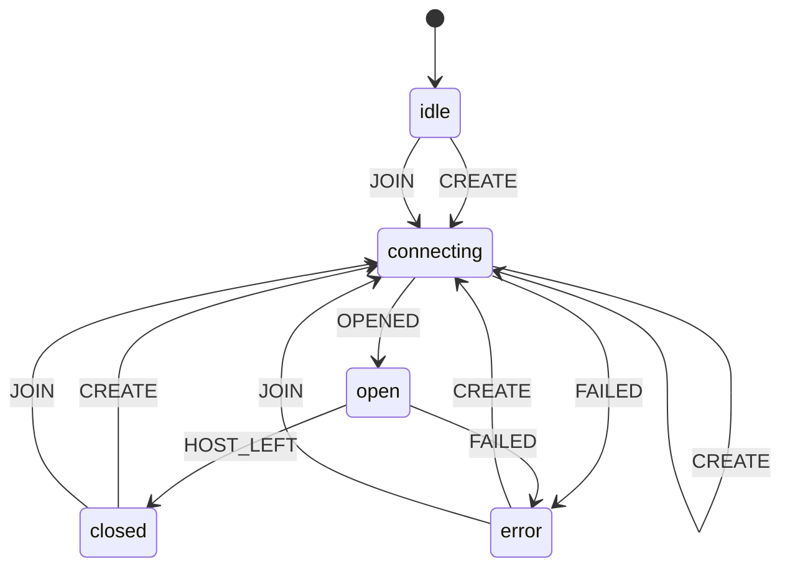

From any state: `LEAVE` goes to `idle`.

| State | Meaning | Events |
|---|---|---|
| `idle` (start) | Not in a room: create one or join with a code | `CREATE` to `connecting`, `JOIN` to `connecting` |
| `connecting` | Opening the room, or joining the host | `OPENED` to `open`, `FAILED` to `error`, `CREATE` to `connecting` |
| `open` | In the room (lobby or playing) | `HOST_LEFT` to `closed`, `FAILED` to `error` |
| `closed` | The host left; the player can create or join again | `CREATE` to `connecting`, `JOIN` to `connecting` |
| `error` | Could not open or join (bad code, full room, network) | `CREATE` to `connecting`, `JOIN` to `connecting` |

## prompt-guesser

Prompt Guesser, 5 rounds: guess the hidden prompt of an AI image; the guess is drawn and judged.

```mermaid
stateDiagram-v2
  [*] --> idle
  idle --> loading-target: START
  loading-target --> guessing: LOADED
  loading-target --> idle: LOAD_FAILED
  guessing --> drawing: GUESS
  drawing --> judging: DRAWN
  drawing --> result: DRAW_FAILED
  judging --> result: JUDGED
  result --> idle: NEXT
  result --> over: FINISH
  over --> [*]
```

From any state: `RESTART` goes to `idle`.

| State | Meaning | Events |
|---|---|---|
| `idle` (start) | Before the round starts | `START` to `loading-target` |
| `loading-target` | The AI draws the mystery image from a hidden prompt | `LOADED` to `guessing`, `LOAD_FAILED` to `idle` |
| `guessing` | The player types a guess (a hint is optional) | `GUESS` to `drawing` |
| `drawing` | The AI draws the player's guess | `DRAWN` to `judging`, `DRAW_FAILED` to `result` |
| `judging` | The AI judge compares the two images | `JUDGED` to `result` |
| `result` | Round score shown with the real prompt | `NEXT` to `idle`, `FINISH` to `over` |
| `over` (end) | All rounds played; final score shown | none |

## speed-prompt

Speed Prompt, 5 rounds: write a prompt in 30 seconds, then the AI draws and the judge scores it.

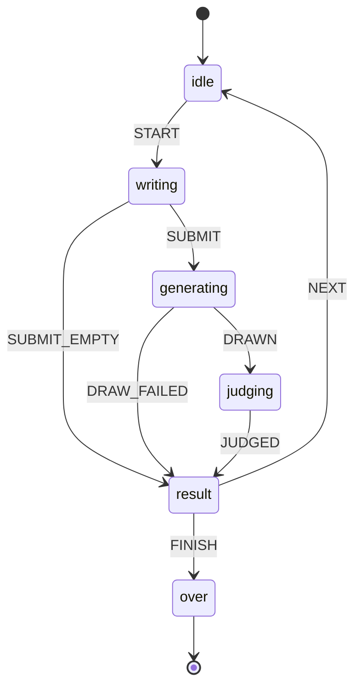

From any state: `RESTART` goes to `idle`.

| State | Meaning | Events |
|---|---|---|
| `idle` (start) | Before the round starts | `START` to `writing` |
| `writing` | The 30 second timer runs; the player types a prompt | `SUBMIT` to `generating`, `SUBMIT_EMPTY` to `result` |
| `generating` | The AI draws the prompt | `DRAWN` to `judging`, `DRAW_FAILED` to `result` |
| `judging` | The AI judge scores the image | `JUDGED` to `result` |
| `result` | Round score shown | `NEXT` to `idle`, `FINISH` to `over` |
| `over` (end) | All rounds played; final score shown | none |

## style-roulette

Style Roulette, 5 rounds: name the art style of an AI image before the 15 second timer runs out.

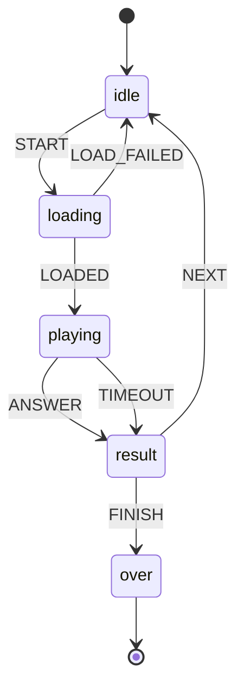

From any state: `RESTART` goes to `idle`.

| State | Meaning | Events |
|---|---|---|
| `idle` (start) | Before the round starts | `START` to `loading` |
| `loading` | The AI draws the styled image | `LOADED` to `playing`, `LOAD_FAILED` to `idle` |
| `playing` | The timer runs; the player picks one of four styles | `ANSWER` to `result`, `TIMEOUT` to `result` |
| `result` | Right style shown with the round score | `NEXT` to `idle`, `FINISH` to `over` |
| `over` (end) | All rounds played; final score shown | none |

## spot-the-fake

Spot the Fake, 5 rounds: find the one image made from a different prompt before the 20 second timer runs out.


From any state: `RESTART` goes to `idle`.

| State | Meaning | Events |
|---|---|---|
| `idle` (start) | Before the round starts | `START` to `loading` |
| `loading` | The AI draws three real images and one fake | `LOADED` to `playing`, `LOAD_FAILED` to `idle` |
| `playing` | The timer runs; the player taps the image they think is fake | `ANSWER` to `result`, `TIMEOUT` to `result` |
| `result` | The fake and both prompts shown with the round score | `NEXT` to `idle`, `FINISH` to `over` |
| `over` (end) | All rounds played; final score shown | none |

## ai-remix

AI Remix: pick a starting image, then make 5 changes; the AI edits the image and the judge scores each change.

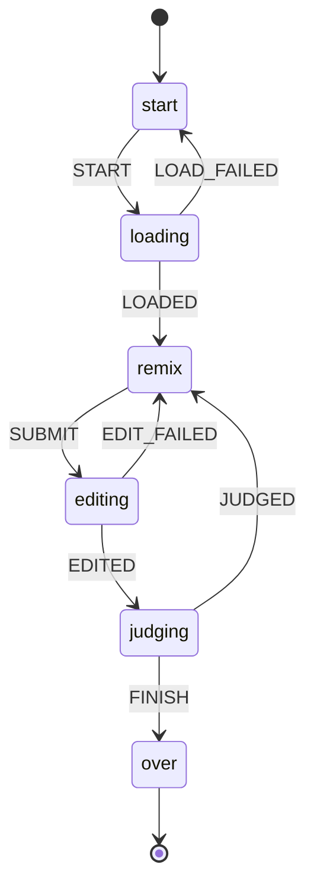

From any state: `RESTART` goes to `start`.

| State | Meaning | Events |
|---|---|---|
| `start` (start) | The player picks or writes a starting prompt | `START` to `loading` |
| `loading` | The AI draws the starting image | `LOADED` to `remix`, `LOAD_FAILED` to `start` |
| `remix` | The player types the next change | `SUBMIT` to `editing` |
| `editing` | The AI edits the current image | `EDITED` to `judging`, `EDIT_FAILED` to `remix` |
| `judging` | The AI judge scores how well the change came through | `JUDGED` to `remix`, `FINISH` to `over` |
| `over` (end) | All changes made; the chain and final score shown | none |

## before-after

Before & After, endless: the AI edits a scene with a chosen transformation and the judge scores it. Each round is saved and shared.

```mermaid
stateDiagram-v2
  [*] --> idle
  idle --> generating-before: NEW_SCENE
  idle --> pick: REUSE_SCENE
  generating-before --> pick: SCENE_READY
  generating-before --> idle: SCENE_FAILED
  pick --> generating-after: APPLY
  pick --> generating-before: NEW_SCENE
  pick --> pick: REUSE_SCENE
  generating-after --> judging: EDITED
  generating-after --> pick: EDIT_FAILED
  judging --> result: JUDGED
  result --> pick: SAME_SCENE
  result --> generating-before: NEW_SCENE
  result --> pick: REUSE_SCENE
```

| State | Meaning | Events |
|---|---|---|
| `idle` (start) | Before the first scene | `NEW_SCENE` to `generating-before`, `REUSE_SCENE` to `pick` |
| `generating-before` | The AI paints the "before" scene | `SCENE_READY` to `pick`, `SCENE_FAILED` to `idle` |
| `pick` | The player picks or types a transformation (or asks for a different scene) | `APPLY` to `generating-after`, `NEW_SCENE` to `generating-before`, `REUSE_SCENE` to `pick` |
| `generating-after` | The AI edits the "before" image with the transformation | `EDITED` to `judging`, `EDIT_FAILED` to `pick` |
| `judging` | The AI judge scores the change | `JUDGED` to `result` |
| `result` | Before and after side by side with the score; the entry goes to the shared gallery | `SAME_SCENE` to `pick`, `NEW_SCENE` to `generating-before`, `REUSE_SCENE` to `pick` |

## dream-caption

Dream Caption solo, 3 rounds: the AI dreams up a surreal image, the player captions it, the AI judge scores the caption.

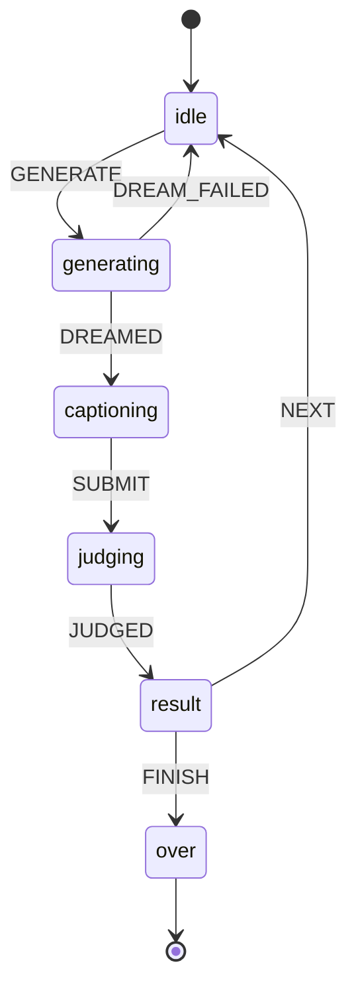

From any state: `RESTART` goes to `idle`.

| State | Meaning | Events |
|---|---|---|
| `idle` (start) | Before the round; the player asks for a dream image | `GENERATE` to `generating` |
| `generating` | The AI draws the dream image | `DREAMED` to `captioning`, `DREAM_FAILED` to `idle` |
| `captioning` | The player writes a caption for the image | `SUBMIT` to `judging` |
| `judging` | The AI judge scores the caption | `JUDGED` to `result` |
| `result` | Round score shown; the caption is posted to the shared gallery | `NEXT` to `idle`, `FINISH` to `over` |
| `over` (end) | All rounds played; final score and caption history shown | none |

## emoji-prompt

Emoji Prompt solo, 5 rounds: describe a scene with emojis only, the AI draws the emojis, the AI judge checks the scene.

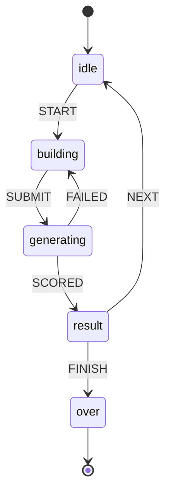

From any state: `RESTART` goes to `idle`.

| State | Meaning | Events |
|---|---|---|
| `idle` (start) | Before the round; the player asks for a scene | `START` to `building` |
| `building` | The player picks emojis for the scene | `SUBMIT` to `generating` |
| `generating` | The AI draws the emojis, then the judge scores the picture | `SCORED` to `result`, `FAILED` to `building` |
| `result` | Round score shown | `NEXT` to `idle`, `FINISH` to `over` |
| `over` (end) | All rounds played; final score shown | none |

## telephone-solo

Solo Telephone, 5 steps: the AI draws a secret prompt, the player describes each image, the judge compares the first and last image.

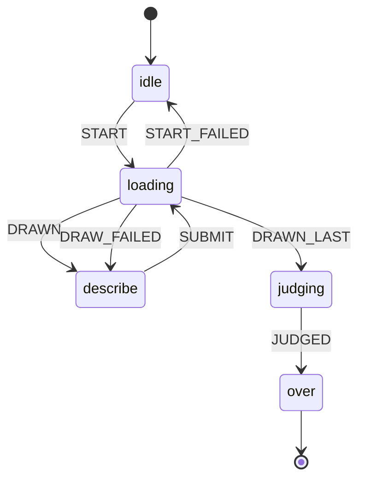

From any state: `RESTART` goes to `idle`.

| State | Meaning | Events |
|---|---|---|
| `idle` (start) | Before the chain starts | `START` to `loading` |
| `loading` | The AI draws the secret prompt or the latest description | `DRAWN` to `describe`, `DRAWN_LAST` to `judging`, `START_FAILED` to `idle`, `DRAW_FAILED` to `describe` |
| `describe` | The player describes the latest image | `SUBMIT` to `loading` |
| `judging` | The AI judge compares the first and last image | `JUDGED` to `over` |
| `over` (end) | Chain complete; score and the whole chain shown | none |

## daily

Daily Challenge: the same 5 images for everyone today, one guess each, then a summary and leaderboard. Logging in or out starts the flow over.

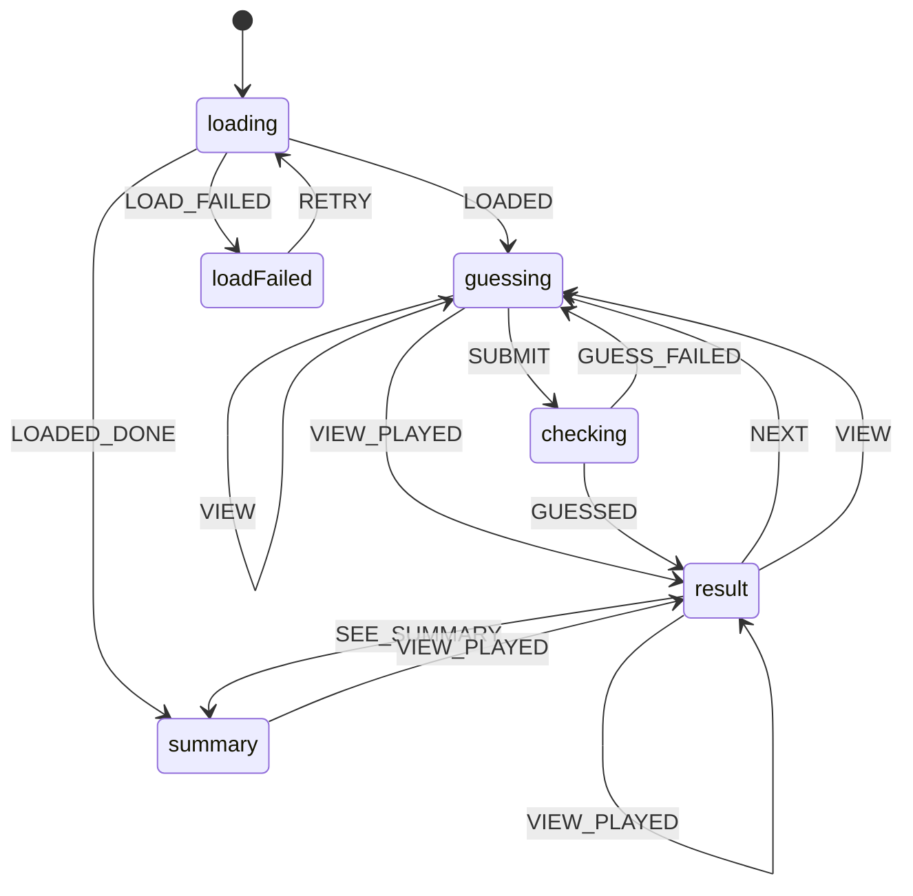

| State | Meaning | Events |
|---|---|---|
| `loading` (start) | Getting today's images and this player's progress | `LOADED` to `guessing`, `LOADED_DONE` to `summary`, `LOAD_FAILED` to `loadFailed` |
| `loadFailed` | Today's challenge could not be loaded | `RETRY` to `loading` |
| `guessing` | An unplayed image is shown; the player writes one guess | `SUBMIT` to `checking`, `VIEW` to `guessing`, `VIEW_PLAYED` to `result` |
| `checking` | The server scores the guess | `GUESSED` to `result`, `GUESS_FAILED` to `guessing` |
| `result` | The score and real prompt for one played image | `NEXT` to `guessing`, `SEE_SUMMARY` to `summary`, `VIEW` to `guessing`, `VIEW_PLAYED` to `result` |
| `summary` | All 5 played: total, share text, and today's leaderboard | `VIEW_PLAYED` to `result` |

## haiku-canvas

Haiku Canvas: write a 5-7-5 haiku, the AI paints it, then it is shared to the gallery. Repeats with no end.

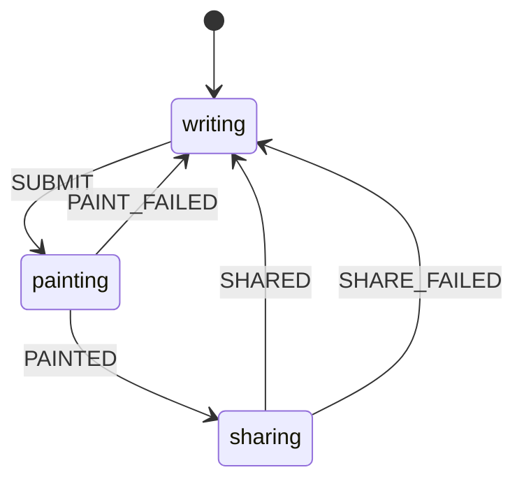

| State | Meaning | Events |
|---|---|---|
| `writing` (start) | The player writes three lines and picks an art style | `SUBMIT` to `painting` |
| `painting` | The AI paints the haiku | `PAINTED` to `sharing`, `PAINT_FAILED` to `writing` |
| `sharing` | The painted haiku is added to the shared gallery (it scores even if this fails) | `SHARED` to `writing`, `SHARE_FAILED` to `writing` |

## community-comic

Community Comic: read the shared comic, write the next panel, the AI draws it and it joins the story.

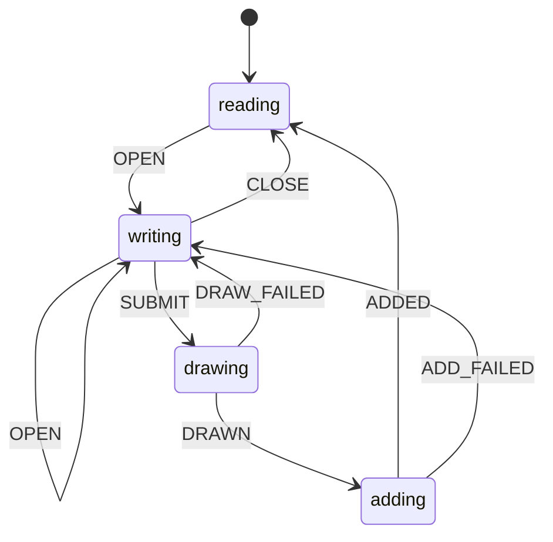

| State | Meaning | Events |
|---|---|---|
| `reading` (start) | Browsing the shared comic pages | `OPEN` to `writing` |
| `writing` | The add-panel form is open; the player writes what happens next | `OPEN` to `writing`, `CLOSE` to `reading`, `SUBMIT` to `drawing` |
| `drawing` | The AI draws the panel from the text and the last panels | `DRAWN` to `adding`, `DRAW_FAILED` to `writing` |
| `adding` | The panel is added to the shared comic | `ADDED` to `reading`, `ADD_FAILED` to `writing` |

## infinimap

Infini-Map: one shared map; tap an empty tile, write a prompt, the AI paints it in the background.

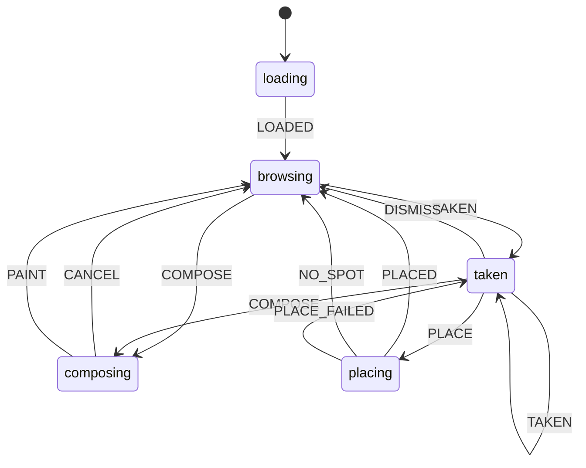

| State | Meaning | Events |
|---|---|---|
| `loading` (start) | First load of the shared map | `LOADED` to `browsing` |
| `browsing` | Panning the map; painted tiles can be inspected; tiles may be painting in the background | `COMPOSE` to `composing`, `TAKEN` to `taken` |
| `composing` | The prompt dialog for one empty tile is open | `CANCEL` to `browsing`, `PAINT` to `browsing` |
| `taken` | Someone took the tile while our art was painting: offer to place the art nearby | `PLACE` to `placing`, `DISMISS` to `browsing`, `COMPOSE` to `composing`, `TAKEN` to `taken` |
| `placing` | Placing the leftover art on the nearest free tile | `PLACED` to `browsing`, `NO_SPOT` to `browsing`, `PLACE_FAILED` to `taken` |

## submit-vote-party

Party round for Dream Caption and Emoji Prompt, run by the host: pick a challenge, everyone submits, everyone votes, results. Every device shows the same phase.

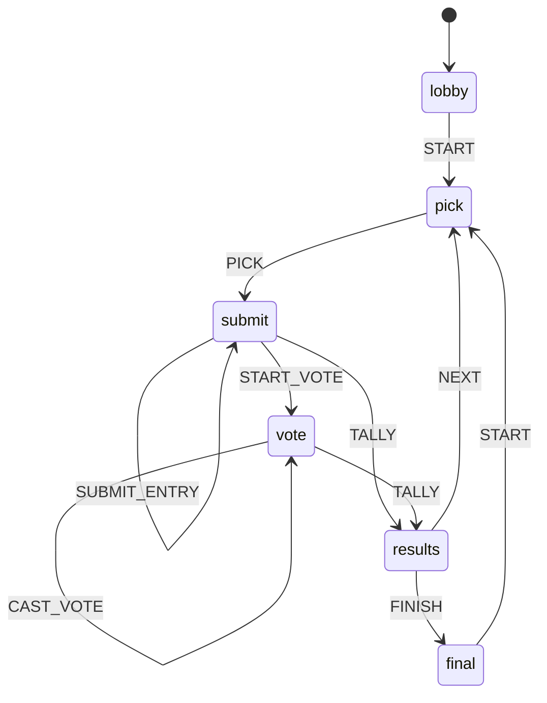

| State | Meaning | Events |
|---|---|---|
| `lobby` (start) | Players join the room; the host starts the game | `START` to `pick` |
| `pick` | The host picks the challenge (a dream image or a scene) | `PICK` to `submit` |
| `submit` | Timer runs; each player makes an entry on their own device. Ends when all have submitted, the host skips, or time is up | `SUBMIT_ENTRY` to `submit`, `START_VOTE` to `vote`, `TALLY` to `results` |
| `vote` | Timer runs; each player votes for one entry that is not theirs. Ends when all have voted, the host skips, or time is up | `CAST_VOTE` to `vote`, `TALLY` to `results` |
| `results` | Round points and standings; the host moves on | `NEXT` to `pick`, `FINISH` to `final` |
| `final` | All rounds played; final standings. The host can play again | `START` to `pick` |

## party-entry

A player's entry in a party round, on their own device: write it, run the AI calls, send it to the host.

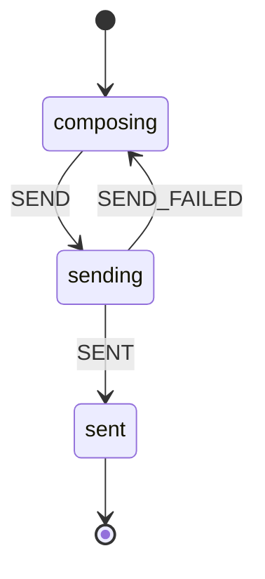

| State | Meaning | Events |
|---|---|---|
| `composing` (start) | The player writes a caption or picks emojis | `SEND` to `sending` |
| `sending` | The AI calls run on this device (image and judge) | `SENT` to `sent`, `SEND_FAILED` to `composing` |
| `sent` (end) | Entry sent to the host; the party screen shows Submitted | none |

## dream-pick

Dream Caption party, host only: make a dream image for everyone to caption, or try a new one.

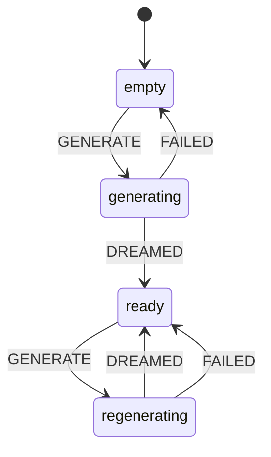

| State | Meaning | Events |
|---|---|---|
| `empty` (start) | No image yet; the host asks for one | `GENERATE` to `generating` |
| `generating` | The AI draws the first dream image | `DREAMED` to `ready`, `FAILED` to `empty` |
| `ready` | The host sees the image: start captions with it, or ask for a new one | `GENERATE` to `regenerating` |
| `regenerating` | The AI draws a new image; the old one stays if this fails | `DREAMED` to `ready`, `FAILED` to `ready` |

## telephone-party

Telephone party (host side): chains rotate between players each step, then the host reveals them and everyone votes.

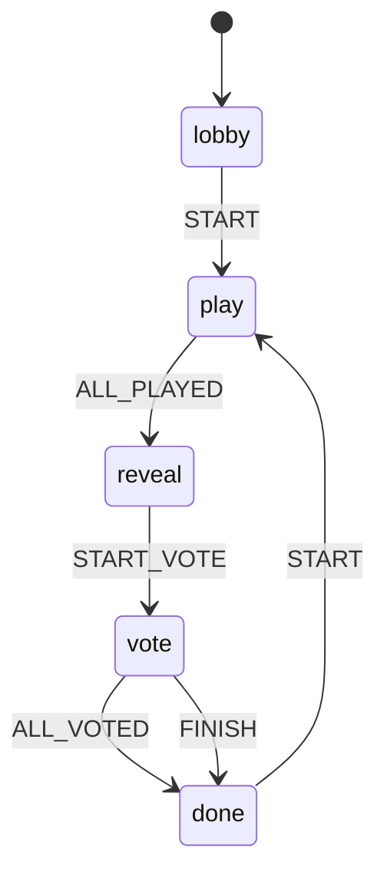

From any state: `NEW_GAME` goes to `lobby`.

| State | Meaning | Events |
|---|---|---|
| `lobby` (start) | Players join; the host starts with 2 or more | `START` to `play` |
| `play` | Each step, every player writes or describes the latest image of one chain | `ALL_PLAYED` to `reveal` |
| `reveal` | The host shows each chain, step by step | `START_VOTE` to `vote` |
| `vote` | Players vote for the funniest chain (not their own) | `ALL_VOTED` to `done`, `FINISH` to `done` |
| `done` | Scores shown; the host can play again | `START` to `play` |

## telephone-turn

My Telephone party turn on this device: write, the AI draws it, then it goes to the host.

```mermaid
stateDiagram-v2
  [*] --> edit
  edit --> drawing: SUBMIT
  drawing --> sent: DRAWN
  drawing --> edit: DRAW_FAILED
  sent --> [*]
```

| State | Meaning | Events |
|---|---|---|
| `edit` (start) | Writing a starting prompt or describing the image | `SUBMIT` to `drawing` |
| `drawing` | The AI draws my words | `DRAWN` to `sent`, `DRAW_FAILED` to `edit` |
| `sent` (end) | Sent to the host; the panel closes when the shared state shows my turn | none |

## prompt-off

Prompt Off duel: two players race 60 seconds to recreate a theme with live AI images, then the audience votes.

```mermaid
stateDiagram-v2
  [*] --> lobby
  lobby --> waiting: CREATE
  lobby --> waiting: JOIN
  waiting --> countdown: START
  waiting --> countdown: HOST_STARTED
  waiting --> lobby: LEAVE
  waiting --> lobby: DISCONNECTED
  countdown --> playing: COUNTDOWN_DONE
  countdown --> lobby: DISCONNECTED
  playing --> generating: SUBMIT
  playing --> generating: TIME_UP
  playing --> lobby: DISCONNECTED
  generating --> voting: OPEN_VOTING
  generating --> results: RESULTS_RECEIVED
  voting --> results: CLOSE_VOTING
  voting --> results: RESULTS_RECEIVED
  results --> waiting: REMATCH
```

From any state: `FAILED` goes to `lobby`.

| State | Meaning | Events |
|---|---|---|
| `lobby` (start) | Create a room or join one with a code | `CREATE` to `waiting`, `JOIN` to `waiting` |
| `waiting` | In the room: the host waits for an opponent and starts; the guest waits for the start | `START` to `countdown`, `HOST_STARTED` to `countdown`, `LEAVE` to `lobby`, `DISCONNECTED` to `lobby` |
| `countdown` | 3, 2, 1 before the round (follows the host clock) | `COUNTDOWN_DONE` to `playing`, `DISCONNECTED` to `lobby` |
| `playing` | The 60 second round: type and sketch, live previews on both screens | `SUBMIT` to `generating`, `TIME_UP` to `generating`, `DISCONNECTED` to `lobby` |
| `generating` | The final image is made; waiting for both finals (at most 15 seconds) | `OPEN_VOTING` to `voting`, `RESULTS_RECEIVED` to `results` |
| `voting` | The audience votes from their phones; the host closes voting | `CLOSE_VOTING` to `results`, `RESULTS_RECEIVED` to `results` |
| `results` | Votes revealed and the match scored; either player can ask for a rematch | `REMATCH` to `waiting` |

## prompt-off-link

Prompt Off player link over PeerJS: the host opens a room, the guest joins it, one opponent at a time.

```mermaid
stateDiagram-v2
  [*] --> idle
  hosting --> connected: OPENED
  joining --> connected: OPENED
  connected --> hosting: OPPONENT_LEFT
  connected --> closed: HOST_LEFT
```

From any state: `CREATE` goes to `hosting`, `JOIN` goes to `joining`, `LEAVE` goes to `idle`, `FAILED` goes to `idle`.

| State | Meaning | Events |
|---|---|---|
| `idle` (start) | No session (the lobby); a failure message may be shown | none |
| `hosting` | Host: the room code is open, waiting for an opponent | `OPENED` to `connected` |
| `joining` | Guest: connecting to the room code (gives up after 10 seconds) | `OPENED` to `connected` |
| `connected` | Both players are linked and can send messages | `OPPONENT_LEFT` to `hosting`, `HOST_LEFT` to `closed` |
| `closed` | Guest: the host left; the game ends the session or keeps showing the results | none |

## prompt-off-vote

Prompt Off audience vote on a phone: join the vote room, pick an image, see the results.

```mermaid
stateDiagram-v2
  [*] --> connecting
  connecting --> voting: VOTE_DATA
  connecting --> results: RESULTS
  connecting --> error: FAILED
  connecting --> error: ROOM_CLOSED
  voting --> voted: VOTE
  voting --> results: RESULTS
  voting --> error: FAILED
  voting --> closed: ROOM_CLOSED
  voted --> results: RESULTS
  voted --> error: FAILED
  voted --> closed: ROOM_CLOSED
  error --> results: RESULTS
  results --> [*]
  closed --> [*]
```

| State | Meaning | Events |
|---|---|---|
| `connecting` (start) | Joining the host vote room (gives up after 10 seconds) | `VOTE_DATA` to `voting`, `RESULTS` to `results`, `FAILED` to `error`, `ROOM_CLOSED` to `error` |
| `voting` | Both images shown; tap one to vote | `VOTE` to `voted`, `RESULTS` to `results`, `FAILED` to `error`, `ROOM_CLOSED` to `closed` |
| `voted` | Vote sent (one per phone); waiting for the host to reveal | `RESULTS` to `results`, `FAILED` to `error`, `ROOM_CLOSED` to `closed` |
| `results` (end) | Winner and vote bars shown; kept even if the room closes | none |
| `closed` (end) | The room closed before the results | none |
| `error` | Could not reach the vote room (bad code or network) | `RESULTS` to `results` |
